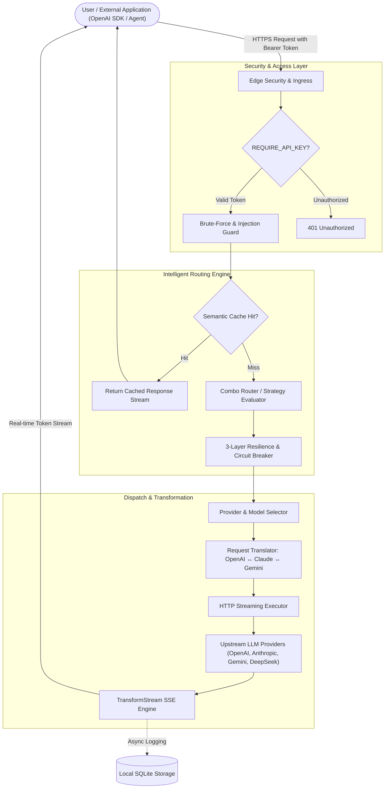

# ⚡ OmniRoute Flow

<div align="center">


### Universal AI Gateway & Intelligent Multi-Provider LLM Router

**One Unified Endpoint · 350+ AI Providers · Auto-Failover · Zero-Trust Security · Real-Time Streaming**

[](https://github.com/janardhan-d/Omniroute-flow)
[](https://nextjs.org/)
[](https://www.typescriptlang.org/)
[](LICENSE)
[](https://www.docker.com/)

</div>

---

## 🌟 Overview

**OmniRoute Flow** is a high-performance, enterprise-grade AI gateway designed to unify, route, and load-balance requests across **350+ Large Language Model (LLM) providers** (OpenAI, Anthropic Claude, Google Gemini, DeepSeek, Grok, Mistral, Local Ollama, and more) through a single standard OpenAI-compatible API.

Built with Next.js 16, TypeScript, SQLite, and a custom SSE streaming pipeline, OmniRoute Flow provides zero-trust key isolation, intelligent fallback chains, real-time token streaming, and full production observability.

---

## 🚀 Key Features

* **🔌 Universal OpenAI Compatibility:** Drop-in replacement for OpenAI SDKs, LangChain, LlamaIndex, Cursor, Claude Code, and any AI agent.
* **🛡️ Zero-Trust Security:** Upstream API keys remain encrypted inside local SQLite (`storage.sqlite`). Client apps never see or touch raw upstream credentials.
* **⚡ 3-Layer Resilience Engine:**
  * **Provider Circuit Breaker:** Detects upstream provider outages (`500/502/503`) and temporarily isolates failing providers.
  * **Connection Cooldown:** Automatically skips rate-limited (`429`) keys while allowing other accounts on the same provider to serve traffic.
  * **Model Lockout:** Isolate unavailable models without disabling the entire connection.
* **🔀 19 Smart Combo Strategies:** Priority, weighted distribution, latency-based, cost-optimized, and auto-combo routing.
* **📊 SEO & Social Ready:** Built-in `sitemap.xml`, `robots.txt`, dynamic OpenGraph cards, Twitter cards, and structured JSON-LD.
* **📜 Complete Legal Suite:** Pre-configured Privacy Policy (`/privacy`) and Terms of Service (`/terms`) detailing local data isolation and GDPR/CCPA compliance.
* **🩺 Production Health Probes:** Native `/healthz`, `/livez`, and `/readyz` endpoints ready for 24/7 uptime monitoring with Uptime Kuma or Better Uptime.

---

## 🏗️ Architecture & Request Lifecycle



---

## 🛠️ Quick Start (Local Setup)

### 1. Clone & Install
```bash
git clone https://github.com/janardhan-d/Omniroute-flow.git
cd Omniroute-flow
npm install
```

### 2. Configure Environment
```bash
cp .env.example .env
```
Generate your random 64-character encryption secrets:
```bash
node -e "console.log(require('crypto').randomBytes(32).toString('hex'))"
```
Ensure your `.env` contains:
```env
PORT=20128
HOST=0.0.0.0
REQUIRE_API_KEY=true
JWT_SECRET=your_generated_jwt_secret
API_KEY_SECRET=your_generated_api_key_secret
DATA_DIR=~/.omniroute
```

### 3. Run the Development Server
```bash
npm run dev
```
Open **[http://localhost:20128](http://localhost:20128)** in your browser to access the management dashboard!

---

## 🌐 100% Free Deployment (No Credit Card Required)

### Method 1: Instant Cloudflare Tunnel (Run from your PC / Server)
Expose your local OmniRoute instance to the public internet with a free permanent HTTPS URL:

1. Install Cloudflare Tunnel:
   ```powershell
   winget install --id Cloudflare.cloudflared
   ```
2. Run your server:
   ```bash
   npm run build && npm run start
   ```
3. Launch the secure tunnel:
   ```bash
   cloudflared tunnel --url http://localhost:20128
   ```
Cloudflare will provide an instant HTTPS link (e.g. `https://xxxx.trycloudflare.com`) with automated SSL and DDoS protection.

---

### Method 2: Render.com (24/7 Cloud Hosting)
1. Fork or push this repository to your GitHub account.
2. Sign in to [Render.com](https://render.com) using GitHub (no credit card needed).
3. Click **New +** → **Web Service** → Select `Omniroute-flow`.
4. Configure:
   * **Runtime:** `Node`
   * **Build Command:** `npm run build`
   * **Start Command:** `npm run start`
   * **Plan:** `Free`
5. Add your environment variables in the Render dashboard and deploy!

---

### Method 3: Docker & Caddy (Self-Hosted with Auto HTTPS)
Run OmniRoute in production with automatic Let's Encrypt SSL certificates and persistent SQLite storage:

```bash
cd src/deploy
docker-compose up -d
```

---

## 💻 API Usage Examples

OmniRoute Flow provides 100% standard OpenAI API compatibility.

### 1. cURL
```bash
curl https://your-domain.com/v1/chat/completions \
  -H "Content-Type: application/json" \
  -H "Authorization: Bearer YOUR_OMNIROUTE_KEY" \
  -d '{
    "model": "gpt-4o",
    "messages": [{"role": "user", "content": "Explain quantum computing in one sentence."}],
    "stream": true
  }'
```

### 2. Python (OpenAI SDK)
```python
from openai import OpenAI

client = OpenAI(
    base_url="https://your-domain.com/v1",
    api_key="YOUR_OMNIROUTE_KEY"
)

response = client.chat.completions.create(
    model="claude-3-5-sonnet",
    messages=[{"role": "user", "content": "Hello OmniRoute!"}],
    stream=True
)

for chunk in response:
    if chunk.choices[0].delta.content:
        print(chunk.choices[0].delta.content, end="", flush=True)
```

### 3. Node.js / TypeScript
```typescript
import OpenAI from "openai";

const openai = new OpenAI({
  baseURL: "https://your-domain.com/v1",
  apiKey: "YOUR_OMNIROUTE_KEY",
});

async function main() {
  const stream = await openai.chat.completions.create({
    model: "gemini-2.5-pro",
    messages: [{ role: "user", content: "Tell me a joke!" }],
    stream: true,
  });

  for await (const chunk of stream) {
    process.stdout.write(chunk.choices[0]?.delta?.content || "");
  }
}

main();
```

---

## 📈 Production Monitoring

OmniRoute Flow exposes native health checks:

| Endpoint | Method | Expected Output | Purpose |
| :--- | :---: | :---: | :--- |
| `/healthz` | `GET` / `HEAD` | `200 OK ("ok")` | Uptime monitors (Uptime Kuma, Better Uptime) |
| `/livez` | `GET` | `200 OK` | Container orchestrator liveness probe |
| `/readyz` | `GET` | `200 OK` | Database migration & readiness probe |

---

## 📄 License & Attribution

Distributed under the MIT License. See `LICENSE` for more information.

Developed and maintained by **[Janardhan Devarala](https://github.com/janardhan-d)**.
